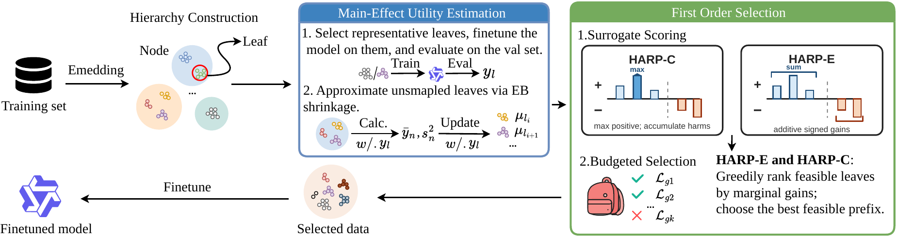

# HARP

Efficient train-based data selection for finetuning large language models.
HARP builds a node–leaf hierarchy over the training pool, measures representative
leaves, and infers the remaining utilities with empirical Bayes. **HARP-C** controls
redundancy; **HARP-E** rewards complementary regions.

Unmeasured leaves use only their parent's measured representatives, with
`weights = softmax(cosine_similarity / interpolation_temperature)` and
`n_eff = 1 / sum(weights**2)`. EB shrinks the weighted estimate using observation
variance `within_parent_variance / n_eff`; measured effects stay unchanged.
`interpolation_temperature=1.0` is an implementation default: the paper gives no
numerical λ. `prior_var=0.01` follows the paper's prior-variance setting. Domain
means pool all measured effects; single-representative parents use pooled
within-parent variance (or `se_floor**2` if none is estimable). Domains with
estimated gains or harms above `epsilon_task` in magnitude stay active.



[Exact Figure 1 PDF](docs/workflow.pdf) · [Paper](https://arxiv.org/abs/2606.07690)

## Install

Python 3.10+; a CUDA GPU is needed for representative finetuning.

```bash
pip install -r requirements.txt
# Optional: faiss-gpu for grouping; vllm for batched inner evaluation.
```

## Select training data

```python
from harp import harp

result = harp(
    X_feat=X_feat,                  # one feature row per training example
    base_model_name="meta-llama/Llama-3.1-8B",
    train_examples=train_examples,  # SFT dicts: input, target, subject
    eval_examples=validation,       # complete fixed held-out validation set
    tokenizer=tokenizer,
    representatives_path="full_validation_baseline.jsonl",
    representative_strategy="farthest_first",  # default; or "kmeans_plus_plus"
    eval_metric="accuracy",
    TOP_K_POINTS=10_000,
)
harp_c_indices = result.harp_c     # indices into train_examples only
harp_e_indices = result.harp_e
```

Within each parent, HARP fits adaptive 1D KMeans regions to raw leaf sizes
using `n * log(RSS / n) + k * log(n)` and allocates `rep_per_parent=3`
representatives across regions in proportion to their leaf counts. Within each
region, `farthest_first` starts with a uniform random leaf, then repeatedly
chooses the remaining leaf with the largest minimum squared Euclidean distance
to the chosen normalized mean leaf embeddings. Ties use input order; duplicate
and zero embeddings still yield unique leaves up to the requested count.
Pass a seeded `rng=np.random.default_rng(seed)` for repeatable selection.

Set `representative_strategy="kmeans_plus_plus"` to use the existing sampler,
which draws subsequent representatives in proportion to their minimum squared
distance. Both strategies are available in `harp(...)`, the standalone
`bootstrap_parent_representative_independent_per_task(...)`, and
`sample_representative_leaf_groups(...)`. In the latter,
`use_diverse=False` takes precedence and retains uniform sampling. Size-region
fitting, allocation, and representative budgets are unchanged; a single
representative has the same selection and RNG behavior under either strategy.
The selected strategy is recorded in result diagnostics.

Every measured model is scored on **all supplied validation rows**, using the
same domains and order throughout selection. Pass the official validation split
or a fixed training holdout; remove holdout rows from the training pool. Keep
final test/evaluation sets separate and never use them for selection. This
library does not construct benchmark splits; callers supply them.

`representatives_path` contains one base-model score per row of that same full
validation set, for example `{"subject": "physics", "acc01": 1.0}`. Domain names
and row counts must match the `subject` labels in `eval_examples`. Scores must
come from those validation rows; count checks cannot establish dataset identity.

**Migration:** remove `eval_indices` and `eval_indices_path`; they are no longer
accepted, and no `eval_indices_<metric>.npy` is loaded. Regenerate old proxy-set
baseline files on the full validation set. Legacy subset checkpoints are
invalidated; new checkpoints fingerprint validation content, order, domains,
and baseline scores. Training hierarchy and training-subset selection remain.
Parent-broadcast checkpoints are also invalidated; the new key includes leaf
embeddings, parent membership, and interpolation/EB settings.
Pre-strategy checkpoints are invalidated for both options. New checkpoint keys
include `representative_strategy`, so switching strategies reruns bootstrap
instead of reusing another strategy's measurements.

## CPU checks

No model downloads or GPU jobs:

```bash
python tests/test_smoke.py
python -m unittest discover -s tests -p 'test_validation_protocol.py' -v
python -m unittest discover -s tests -p 'test_interpolation.py' -v
python -m unittest discover -s tests -p 'test_representatives.py' -v
```
