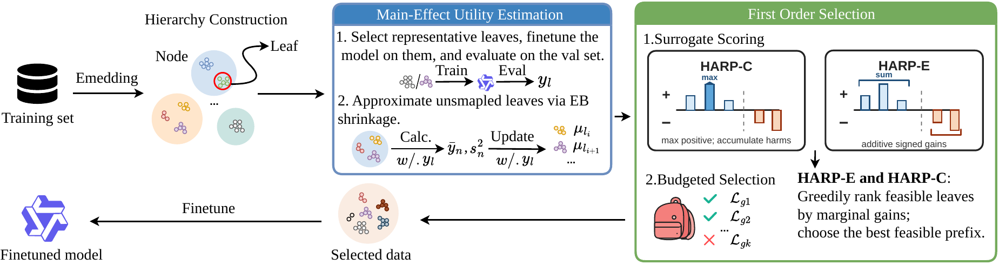

# HARP

Efficient train-based data selection for finetuning large language models.
HARP builds a node–leaf hierarchy over the training pool, measures representative
leaves, and infers the remaining utilities with empirical Bayes. **HARP-C** controls
redundancy; **HARP-E** rewards complementary regions.



[Exact Figure 1 PDF](docs/workflow.pdf) · [Paper](https://arxiv.org/abs/2606.07690)

## Install

Python 3.10+; a CUDA GPU is needed for representative finetuning.

```bash
pip install -r requirements.txt
# Optional: faiss-gpu for grouping; vllm for batched inner evaluation.
```

## Select training data

```python
from harp import harp

result = harp(
    X_feat=X_feat,                  # one feature row per training example
    base_model_name="meta-llama/Llama-3.1-8B",
    train_examples=train_examples,  # SFT dicts: input, target, subject
    eval_examples=validation,       # complete fixed held-out validation set
    tokenizer=tokenizer,
    representatives_path="full_validation_baseline.jsonl",
    eval_metric="accuracy",
    TOP_K_POINTS=10_000,
)
harp_c_indices = result.harp_c     # indices into train_examples only
harp_e_indices = result.harp_e
```

Every measured model is scored on **all supplied validation rows**, using the
same domains and order throughout selection. Pass the official validation split
or a fixed training holdout; remove holdout rows from the training pool. Keep
final test/evaluation sets separate and never use them for selection. This
library does not construct benchmark splits; callers supply them.

`representatives_path` contains one base-model score per row of that same full
validation set, for example `{"subject": "physics", "acc01": 1.0}`. Domain names
and row counts must match the `subject` labels in `eval_examples`. Scores must
come from those validation rows; count checks cannot establish dataset identity.

**Migration:** remove `eval_indices` and `eval_indices_path`; they are no longer
accepted, and no `eval_indices_<metric>.npy` is loaded. Regenerate old proxy-set
baseline files on the full validation set. Legacy subset checkpoints are
invalidated; new checkpoints fingerprint validation content, order, domains,
and baseline scores. Training hierarchy and training-subset selection remain.

## CPU checks

No model downloads or GPU jobs:

```bash
python tests/test_smoke.py
python -m unittest discover -s tests -p 'test_validation_protocol.py' -v
```
